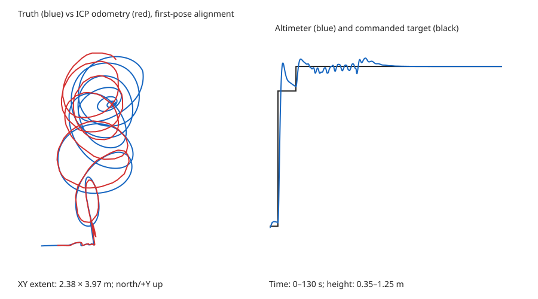
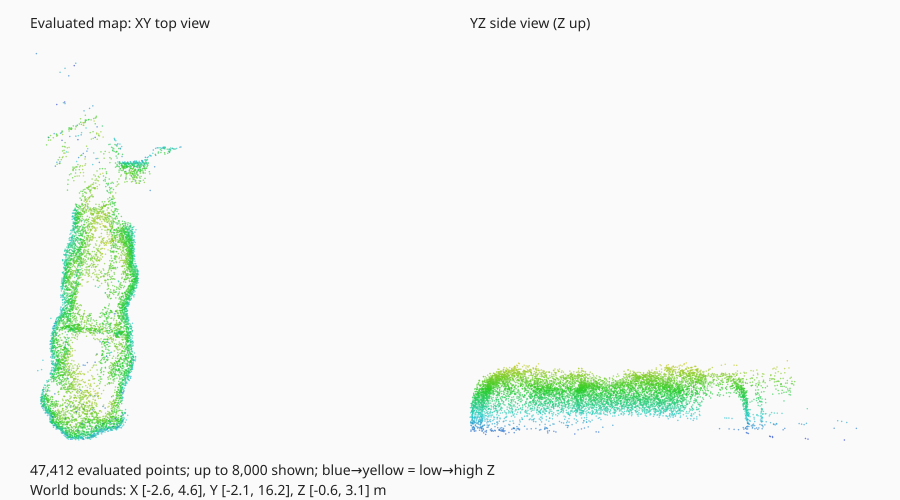
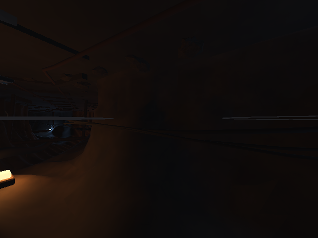
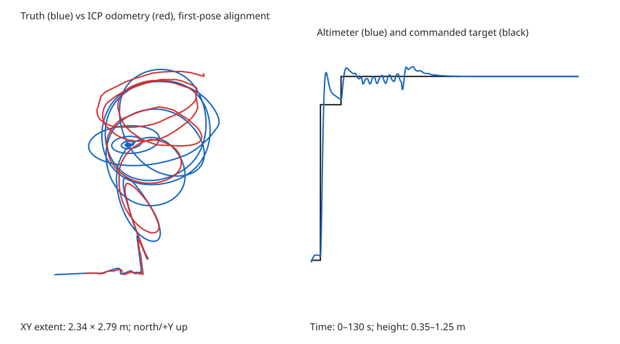
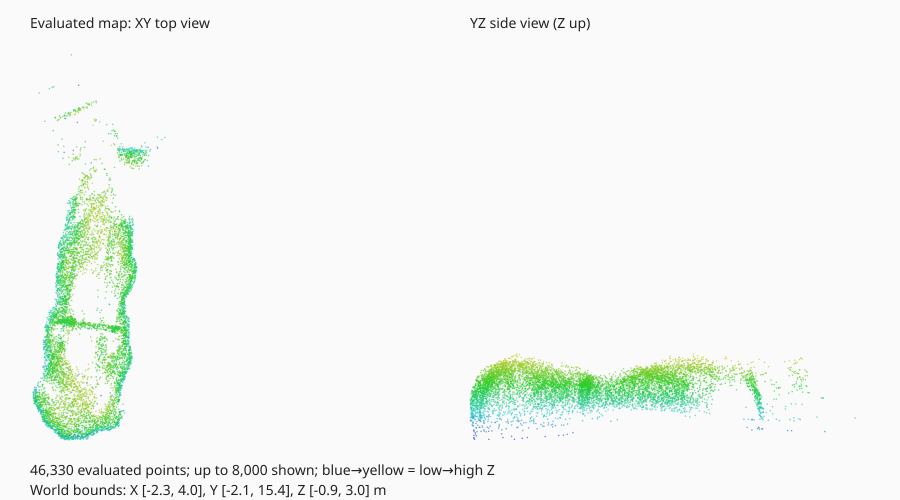
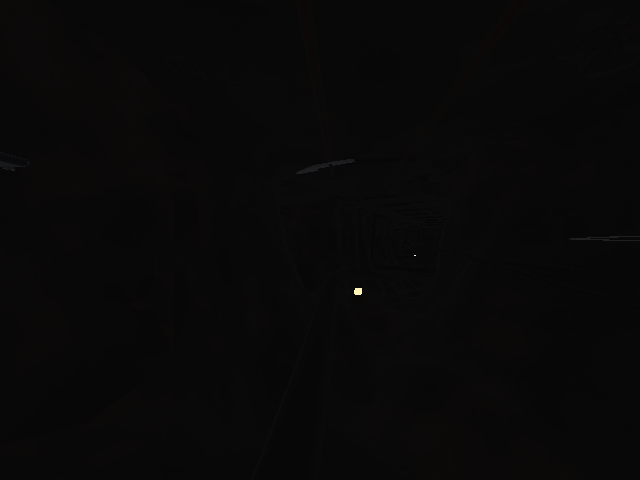

# Cerro Rico SIL evidence

These are measured results for the entrance-corridor trial. Failed checks remain failures.

| Trial | Scenario | Overall | Altitude RMSE (m) | Odometry RMSE (m) | Drift at last valid pose (m) | Surface P95 (m) | Map points |
| --- | --- | --- | --- | --- | --- | --- | --- |
| [cerro_nominal_final](cerro_nominal_final/report.md) | nominal | FAIL | 0.0091 | 0.2518 | 0.5458 | 0.3501 | 47412 |
| [cerro_low_light_final](cerro_low_light_final/report.md) | low_light | FAIL | 0.0100 | 0.3561 | 0.6108 | 0.4146 | 46330 |

## cerro_nominal_final

Failed checks: odometry_end_drift, route_return, camera_contrast.
Last retained valid odometry stamp: **48.568 s** of a 130.0 s trial.
Raw run directory: `experiment_data/sil/cerro_nominal_final/` (ignored by Git).

## cerro_low_light_final

Failed checks: odometry, odometry_end_drift, route_progress, route_return, camera_exposure, camera_contrast.
Last retained valid odometry stamp: **44.304 s** of a 130.0 s trial.
Raw run directory: `experiment_data/sil/cerro_low_light_final/` (ignored by Git).

## Tracking availability correction

The original rate check counts all published odometry messages, including invalid/null estimates. It is a transport-rate check, not continuous localization availability.
Position RMSE and the JSON field `end_drift_m` cover retained valid estimates only; the latter is drift at the last valid pose, not necessarily the end of the 130-second trial.
In these final runs, valid ICP odometry stopped before the return leg scheduled at 70 s. The fixture stops horizontal commands once the last valid estimate is 0.5 s old. Therefore return failure includes tracking loss and cannot be attributed solely to position-controller tuning.
The original per-check JSON results are retained. Their overall FAIL verdict is unchanged; a future acceptance suite also needs valid-estimate availability and recovery checks.

## Scope

Ground truth is evaluation-only. The horizontal route controller is an odometry-driven test fixture.
Map residuals use a sampled, simplified simulation collision surface; they do not establish surveyed accuracy or full-mine coverage.
These results do not validate ArduPilot firmware, hardware, dust, communications faults, gas detection, battery endurance, or every branch of the mine.
